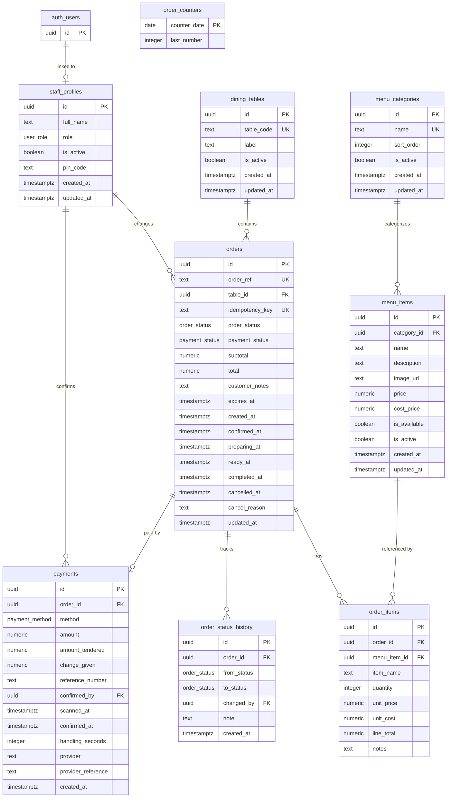

# MESA-AI Database

## Migration Changelog

| # | File name | Description | Author | Created | Status | Applied date |
| --- | --- | --- | --- | --- | --- | --- |
| 1 | `20261122100000_extensions_enums_and_helpers.sql` | Enable pgcrypto, create shared enums, and add the updated-at trigger function. | TBD | 2026-11-22 | Applied | 2026-11-22 |
| 2 | `20261122100100_staff_and_tables.sql` | Create staff profiles and dining tables. | TBD | 2026-11-22 | Applied | 2026-11-22 |
| 3 | `20261122100200_menu.sql` | Create menu categories and menu items. | TBD | 2026-11-22 | Applied | 2026-11-22 |
| 4 | `20261122100300_orders.sql` | Create order counters, orders, order items, and order status history. | TBD | 2026-11-22 | Applied | 2026-11-22 |
| 5 | `20261122100400_payments.sql` | Create payment records for counter and future online payments. | TBD | 2026-11-22 | Applied | 2026-11-22 |
| 6 | `20261122100500_indexes_triggers_and_rls.sql` | Add operational and analytics indexes, updated-at triggers, and RLS. | TBD | 2026-11-22 | Applied | 2026-11-22 |
| 7 | `20261122100600_create_order_function.sql` | Add the atomic customer order creation RPC function. | TBD | 2026-11-22 | Applied | 2026-11-22 |
| 8 | `20261124100000_staff_pin.sql` | Add `pin_code` column to `staff_profiles` for quick POS shift switching. | Dev 2 | 2026-11-24 | Pending | — |
| 9 | `20261125100000_fix_drinks_category_and_order_check.sql` | Reactivate Drinks category, backfill/scrub PIN metadata, and check parent category `is_active` in `create_order`. | Dev 2 | 2026-11-25 | Pending | — |

## Seed Data

| File name | Purpose | Date applied | Environment | Safe to re-run |
| --- | --- | --- | --- | --- |
| `001_dev_menu_and_tables.sql` | Seed 4 menu categories, 13 menu items, and 10 dining tables. | 2026-11-22 | DEV ONLY | Yes |

Seed data must never be run against production data.

## ERD

## Data Dictionary

### `staff_profiles`

| Column | Type | Purpose |
| --- | --- | --- |
| `id` | `uuid` | Primary key and matching Supabase Auth user identifier. |
| `full_name` | `text` | Staff member display name. |
| `role` | `user_role` | Application role: admin, cashier, or kitchen. |
| `is_active` | `boolean` | Whether the account is active. |
| `pin_code` | `text` | Optional 4-to-6 digit numeric PIN for quick POS shift switching (added in `20261124100000_staff_pin.sql`). |
| `created_at` | `timestamptz` | Profile creation time. |
| `updated_at` | `timestamptz` | Last profile update time. |

### `dining_tables`

| Column | Type | Purpose |
| --- | --- | --- |
| `id` | `uuid` | Primary key. |
| `table_code` | `text` | Unique code embedded in a table QR URL. |
| `label` | `text` | Human-readable table name or number. |
| `is_active` | `boolean` | Whether the table accepts new orders. |
| `created_at` | `timestamptz` | Table creation time. |
| `updated_at` | `timestamptz` | Last table update time. |

### `menu_categories`

| Column | Type | Purpose |
| --- | --- | --- |
| `id` | `uuid` | Primary key. |
| `name` | `text` | Unique category name. |
| `sort_order` | `integer` | Customer-facing display order. |
| `is_active` | `boolean` | Whether the category is active. |
| `created_at` | `timestamptz` | Category creation time. |
| `updated_at` | `timestamptz` | Last category update time. |

### `menu_items`

| Column | Type | Purpose |
| --- | --- | --- |
| `id` | `uuid` | Primary key. |
| `category_id` | `uuid` | Parent menu category. |
| `name` | `text` | Menu item name. |
| `description` | `text` | Optional item description. |
| `image_url` | `text` | Optional item image URL. |
| `price` | `numeric(10,2)` | Current selling price in PHP. |
| `cost_price` | `numeric(10,2)` | Estimated cost per serving in PHP. |
| `is_available` | `boolean` | Manual sold-out availability flag. |
| `is_active` | `boolean` | Soft-delete flag. |
| `created_at` | `timestamptz` | Item creation time. |
| `updated_at` | `timestamptz` | Last item update time. |

### `order_counters`

| Column | Type | Purpose |
| --- | --- | --- |
| `counter_date` | `date` | Date for the daily order sequence. |
| `last_number` | `integer` | Last generated sequence number for the date. |

### `orders`

| Column | Type | Purpose |
| --- | --- | --- |
| `id` | `uuid` | Primary key. |
| `order_ref` | `text` | Human-readable `ORD-YYYYMMDD-0001` reference. |
| `table_id` | `uuid` | Dining table associated with the order. |
| `idempotency_key` | `text` | Unique key preventing duplicate order submissions. |
| `order_status` | `order_status` | Fulfillment lifecycle status. |
| `payment_status` | `payment_status` | Separate payment lifecycle status. |
| `subtotal` | `numeric(10,2)` | Sum of order item line totals. |
| `total` | `numeric(10,2)` | Final amount due in PHP. |
| `customer_notes` | `text` | Optional customer instructions. |
| `expires_at` | `timestamptz` | Automatic expiration time for unpaid orders. |
| `created_at` | `timestamptz` | Order creation time. |
| `confirmed_at` | `timestamptz` | Time the paid order was confirmed. |
| `preparing_at` | `timestamptz` | Time preparation began. |
| `ready_at` | `timestamptz` | Time the order became ready. |
| `completed_at` | `timestamptz` | Time the order was completed. |
| `cancelled_at` | `timestamptz` | Time the order was cancelled. |
| `cancel_reason` | `text` | Optional cancellation reason. |
| `updated_at` | `timestamptz` | Last order update time. |

### `order_items`

| Column | Type | Purpose |
| --- | --- | --- |
| `id` | `uuid` | Primary key. |
| `order_id` | `uuid` | Parent order. |
| `menu_item_id` | `uuid` | Reference to the source menu item. |
| `item_name` | `text` | Item name snapshot. |
| `quantity` | `integer` | Ordered quantity. |
| `unit_price` | `numeric(10,2)` | Selling price snapshot in PHP. |
| `unit_cost` | `numeric(10,2)` | Item cost snapshot in PHP. |
| `line_total` | `numeric(10,2)` | Quantity multiplied by unit price. |
| `notes` | `text` | Optional item instructions. |

### `order_status_history`

| Column | Type | Purpose |
| --- | --- | --- |
| `id` | `uuid` | Primary key. |
| `order_id` | `uuid` | Parent order. |
| `from_status` | `order_status` | Previous status; may be null. |
| `to_status` | `order_status` | New status. |
| `changed_by` | `uuid` | Optional staff profile responsible. |
| `note` | `text` | Optional transition note. |
| `created_at` | `timestamptz` | Status transition time. |

### `payments`

| Column | Type | Purpose |
| --- | --- | --- |
| `id` | `uuid` | Primary key. |
| `order_id` | `uuid` | Unique paid order reference. |
| `method` | `payment_method` | Cash, GCash, or future online method. |
| `amount` | `numeric(10,2)` | Payment amount in PHP. |
| `amount_tendered` | `numeric(10,2)` | Cash received; nullable for other methods. |
| `change_given` | `numeric(10,2)` | Cash change returned. |
| `reference_number` | `text` | GCash or external payment reference. |
| `confirmed_by` | `uuid` | Confirming staff profile. |
| `scanned_at` | `timestamptz` | Time the cashier loaded or scanned the order. |
| `confirmed_at` | `timestamptz` | Time payment was confirmed. |
| `handling_seconds` | `integer` | Scan-to-confirmation queue metric. |
| `provider` | `text` | Future online provider name. |
| `provider_reference` | `text` | Future provider transaction identifier. |
| `created_at` | `timestamptz` | Payment record creation time. |

## RPC Functions

### `public.create_order`

The `create_order(p_table_code, p_idempotency_key, p_customer_notes, p_items, p_expiry_minutes)` RPC atomically creates or repeats a customer order.

| Parameter | Type | Purpose |
| --- | --- | --- |
| `p_table_code` | `text` | QR code of the active dining table. |
| `p_idempotency_key` | `text` | Unique submission key preventing duplicate orders. |
| `p_customer_notes` | `text` | Optional notes for the whole order. |
| `p_items` | `jsonb` | Menu item IDs, quantities, and item notes. |
| `p_expiry_minutes` | `integer` | Minutes before an unpaid order expires. |

The function validates the table and every menu item, merges repeated items, snapshots prices and costs, creates the order and status history, and returns a JSON order object.

Its return object can be:

- A new order: `isNew = true`, the order reference and statuses, subtotal and total, expiration, table, items, and status timestamps.
- An existing idempotent order: `isNew = false`, with the same stored order details.
- An error object: `errorCode` and `message`, plus `itemName` or `menuItemId` when applicable.

Error codes:

- `INVALID_REQUEST`: Missing idempotency key or invalid item structure or quantity.
- `TABLE_INVALID`: The table code is unknown or inactive.
- `ITEM_MISSING`: The requested menu item does not exist.
- `ITEM_INACTIVE`: The menu item is inactive.
- `ITEM_SOLD_OUT`: The menu item is sold out.

## Enums

### `user_role`

- `admin`
- `cashier`
- `kitchen`

### `order_status`

- `pending`
- `confirmed`
- `preparing`
- `ready`
- `completed`
- `cancelled`
- `expired`

### `payment_status`

- `unpaid`
- `paid`
- `cancelled`

### `payment_method`

- `cash`
- `gcash`
- `online`

## Design Decisions

- Order item records store `item_name`, `unit_price`, and `unit_cost` snapshots so menu changes do not alter historical order or profit calculations.
- Menu items use `is_active` as a soft-delete flag; they are never hard-deleted because orders continue to reference them.
- `order_status` and `payment_status` are separate columns so fulfillment and payment lifecycles can evolve independently.
- `idempotency_key` is unique and prevents duplicate customer order submissions.
- Row Level Security is enabled on every table. The Express backend uses the Supabase service role and enforces application roles itself, while no anon policies are created. Never expose or use the service role key in client code.
- Gross profit is sales revenue minus the cost snapshots on sold order items. It does not represent net profit.
- Online payments are represented by `payment_method.online` plus nullable provider fields, allowing future providers without redesigning the core payment schema.

## How to Add a Migration

1. Name the file using `YYYYMMDDHHMMSS_short_snake_case_description.sql`.
2. Create a later timestamp than every existing migration.
3. Add the standard header comment with purpose, author, date, dependency, and affected tables.
4. Keep the migration limited to one logical database change.
5. Use IF NOT EXISTS where safe and never modify an applied migration.
6. Add important table and column comments.
7. End the file with a manual rollback SQL block under `-- DOWN (manual rollback)`.
8. Add the migration to this changelog with status `Pending`.
9. Paste and execute the migration in the Supabase SQL Editor after review.
10. Update the status to `Applied` and record the application date.
